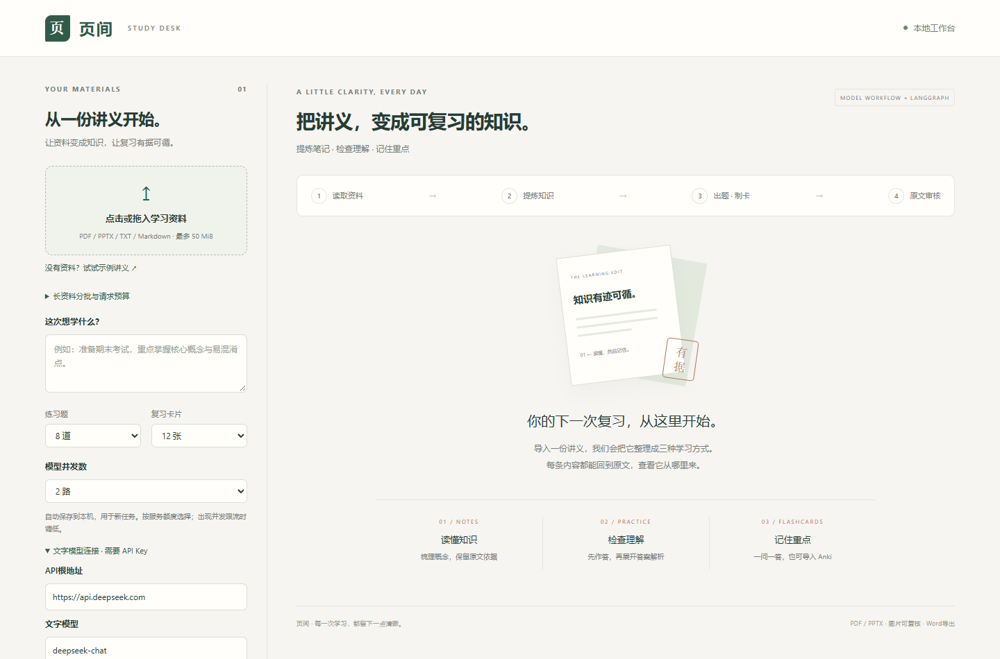
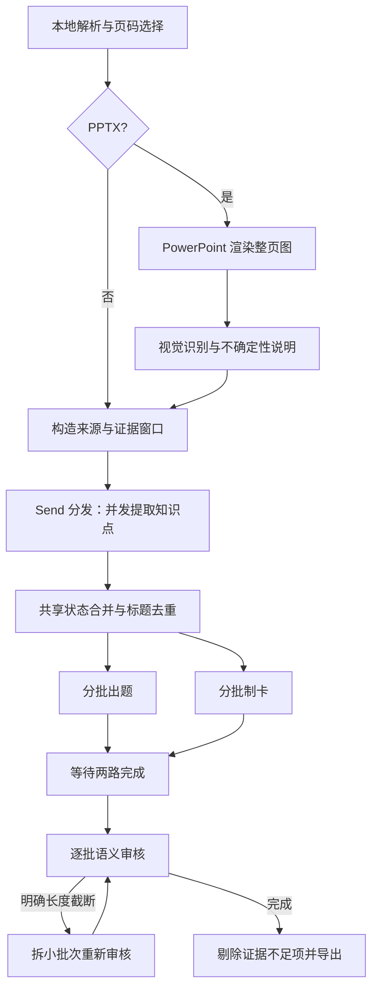

# 页间 · Yejian Study Assistant

**把讲义变成可追溯的笔记、练习题和复习卡片。**

基于 Python、LangGraph 和兼容 Chat Completions 的模型接口构建的本地学习工具。面向讲义整理与教师备课场景：导入 PDF、PPTX、TXT 或 Markdown，生成带出处的学习资料，并导出 Word、Markdown、Anki TSV 和 JSON。



截图为无真实资料、无 Key 的初始界面。

## 能做什么

| 能力 | 实现 |
| --- | --- |
| 讲义导入 | PDF 文字提取、PPTX 文字与整页视觉识别、TXT/Markdown |
| 多角色工作流 | 分段提取知识点，出题与制卡并行，汇聚后审核 |
| 可追溯引用 | 模型选择证据编号，程序回填摘录并匹配原文 |
| 有界恢复 | 结构校验、一次格式修正、审核截断后拆批、请求总预算 |
| 模型自定义 | API 根地址、模型列表与手填回退、独立文字/视觉连接 |
| 并发配置 | 1–8 路可选，默认 2 路；任务保留提交时快照 |
| 本地保存 | SQLite 历史；可选择用 Windows DPAPI 加密保存连接 |
| 资料导出 | 可编辑 DOCX、Markdown、Anki 两列 TSV、结构化 JSON |

这是一个可运行的个人作品集初版。工作流由程序定义，各节点使用模型完成指定角色的任务；当前没有让自主 Agent 任意决定工具和下一步。

## 快速开始

运行基线为 **Windows + Python 3.13**。处理 PPTX 还需要本机 **Microsoft PowerPoint** 及支持图片输入的模型；PDF/TXT/Markdown 不需要 Office。WPS、扫描 PDF OCR 和跨平台 PPTX 渲染暂不支持。

克隆或解压本仓库，在仓库根目录打开 PowerShell：

```powershell
py -3.13 -m venv .venv
& .\.venv\Scripts\python.exe .\install_packages.py -r .\requirements.txt
& .\.venv\Scripts\python.exe -X utf8 .\app.py
```

打开 [http://127.0.0.1:8765](http://127.0.0.1:8765)。后续可双击 `启动学习助手.cmd`，保持后台终端运行，`Ctrl+C` 停止。端口占用时加 `--port 8766`；更新 Python 代码后需重启后台。

安装助手先使用[清华 PyPI 镜像](https://pypi.tuna.tsinghua.edu.cn/simple)，只有明确缺包或缺版本时才单独重试官方 PyPI，不使用 `extra-index-url` 混合来源。Python 包镜像不用于下载 GitHub 源码。

## 第一次使用

1. 点击“试用示例讲义”或导入自己的资料。预览仅本地解析，不调用模型。
2. 填 API 根地址、Key 和模型名；也可先获取模型列表再选择。列表接口不支持时手填即可。默认示例地址为 `https://api.deepseek.com`。
3. 分别测试文字和视觉能力。导入 PPTX 时，确认视觉模型与图片发送地址，勾选同意；生成前先保存并关闭所有 PowerPoint 窗口。
4. 选择练习题、卡片数量与并发数，点击生成。连接测试和生成都会消耗所选服务的 API 用量。
5. 查看笔记、展开答案、翻卡片，点击出处核对。审核可能剔除不可靠条目，因此实际数量可能少于请求数量。
6. 下载 Word、Markdown、Anki 或 JSON。导入 Anki 时选择制表符分隔，第一列正面、第二列背面。

网页中的“加密保存连接”是可选项。不保存时 Key 只用于内存；保存后由 Windows 当前用户 DPAPI 加密，下次可复用。原文件、结果和历史位于 `data/`，请勿提交到 GitHub。详细说明见 [配置与使用](docs/USAGE.md)。

## 编排体现在哪里



关键在于 **任务分发、共享状态、并行汇聚和失败恢复**，不只是给同一次聊天换几个角色名。出题和制卡只收到本批知识点与所需证据，避免把前面所有输出不断堆进上下文。

引用匹配能检查摘录是否存在，模型审核进一步检查结论是否得到证据支持；两者都不能保证事实绝对正确。视觉识别内容明确标为“模型识别”，重要数值与图表仍需核对原图。详见 [架构与实现](docs/ARCHITECTURE.md)。

## 验证结果

- **65 项自动测试通过**：覆盖真实 LangGraph 图执行、并行汇聚、引用校验、截断拆批、全局请求预算、并发限额、HTTP 下载、配置与凭据隔离。测试中的模型响应使用替代数据，不消耗真实 API。
- **真实模型流程已验证**：一份 13 页课件复用已有幻灯片图片，真实调用 DeepSeek 完成识别、生成及 22 批审核。108 条候选剔除 6 条证据不足项，保留 **86 条笔记、7 道题、9 张卡片**；引用与四种导出通过校验。
- 真实测试没有重新启动 PowerPoint；DOCX 做了结构复读，尚未做逐页视觉检查。没有据此宣称所有厂商、中转或模型都兼容，也没有量化“正确率提升”。

```powershell
& .\.venv\Scripts\python.exe -X utf8 -m unittest discover -s .\tests -v
```

测试与验证边界见 [验证说明](docs/VERIFICATION.md)。仓库不包含真实课件、真实结果、历史数据库或模型 Key。

## 当前边界

- 仅监听本机 `127.0.0.1`，用于个人本地运行；没有账号体系或多用户权限控制。
- 文件最大 50 MiB；PDF/PPTX 最多 200 页。单次选中最多 60,000 字符、24 个文字段；PPTX 另限 24 张图片，可按页码分批。
- PDF 暂不识别扫描件与其中图片的语义；PPTX 不纳入演讲备注、动画过程和视频，旧 `.ppt` 请另存为 `.pptx`。
- 只实现兼容 Chat Completions 的接口；模型列表可用不代表文字、视觉和 JSON 能力都可用。
- 并发和重试会增加用量。遇到 429 需核对服务额度与限流；调低并发不能解决所有 429。
- 长资料按批处理并按数量抽样出题，不保证覆盖全部知识点；程序退出后不支持自动续跑未完成任务。

## 项目结构

```text
app.py                  本机 HTTP 服务、任务队列、历史与下载
engine.py               LangGraph 图、模型节点、证据交接与审核恢复
documents.py            文档解析、范围选择、证据窗口与请求预算
model_connection.py     模型配置、探测、并发限流与厂商参数
credentials.py          Windows DPAPI 加密保存
pptx_render.py          PowerPoint 渲染与进程所有权检查
exports.py              Word / Markdown / Anki 导出
runtime_settings.py     非敏感运行偏好保存
static/                 原生 HTML / CSS / JavaScript 界面
tests/                  自动测试与合成两页课件
docs/                   使用说明、架构、验证与面试讲解
```

## 用于简历与答辩

可以围绕“多角色工作流、证据可追溯、并行控制、失败恢复、本地产品落地”讲解。请结合自己实际理解和完成的工作介绍，不写未经测量的性能或准确率提升。

参见 [项目介绍与答辩提纲](docs/PORTFOLIO.md)。

## 许可证

项目代码使用 [MIT License](LICENSE)。主要第三方依赖各自受原许可证约束，见 [第三方说明](THIRD_PARTY_NOTICES.md)。本项目不是 OpenAI、DeepSeek 或 Microsoft 的官方产品，也不附带模型服务或 Office 授权。
